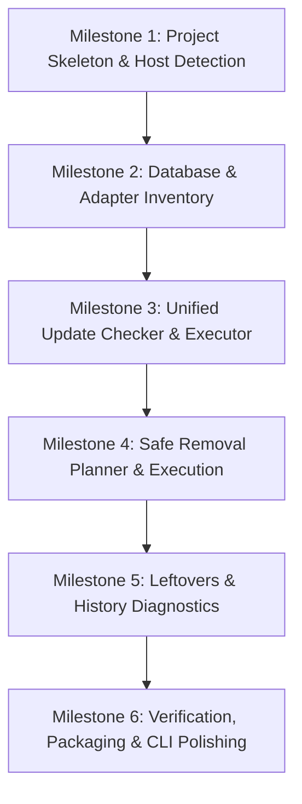

# Universal Linux Update Manager (ULUM) — Implementation Plan

## 1. Executive Summary & Ponytail Baseline

Universal Linux Update Manager (`ulum`) orchestrates native package managers (APT, Flatpak, Snap) on Linux Mint 22.x and Ubuntu 24.04 LTS through a unified CLI. 

Following **Ponytail** principles (minimum code, zero premature abstractions, platform native tools first):
- **Core Architecture:** Modular adapter pattern delegating directly to native binaries (`apt-get`, `dpkg-query`, `flatpak`, `snap`).
- **Storage:** Standard library `sqlite3` with parameterized queries (no heavy ORM like SQLAlchemy).
- **CLI & Output:** `typer` + `rich` for crisp terminal UI, argument validation, and interactive confirmations.
- **Scope Discipline:** Focus strictly on MVP (APT, Flatpak, Snap, Unified Check/Update, Safe Removal Plan, History, and Doctor). Defer Phase 5 (AppImage & custom vendor manifests) and Phase 6 (Textual TUI & desktop notifications) to subsequent iterations.

---

## 2. Project Architecture & Directory Layout

```text
universal-linux-update-manager/
├── pyproject.toml              # Build & dependency spec (hatchling/flit, typer, rich)
├── README.md
├── LICENSE
├── docs/
│   ├── PRD.md
│   └── IMPLEMENTATION_PLAN.md
├── src/
│   └── ulum/
│       ├── __init__.py         # Package metadata (__version__)
│       ├── main.py             # CLI entrypoint
│       ├── cli/
│       │   ├── __init__.py
│       │   ├── app.py          # Typer application instance & command definitions
│       │   └── display.py      # Rich tables, formatting, dry-run banners
│       ├── core/
│       │   ├── __init__.py
│       │   ├── models.py       # Dataclasses: ApplicationRecord, UpdateRecord, RemovalPlan
│       │   ├── system.py       # OS detection (/etc/os-release), architecture, tool discovery
│       │   ├── orchestrator.py # Cross-adapter coordination for scan, check, update
│       │   └── config.py       # TOML configuration loader (~/.config/ulum/config.toml)
│       ├── adapters/
│       │   ├── __init__.py
│       │   ├── base.py         # BaseAdapter ABC
│       │   ├── apt.py          # APT/DEB adapter (dpkg, apt-get, apt-cache)
│       │   ├── flatpak.py      # Flatpak adapter (user & system scopes)
│       │   └── snap.py         # Snap adapter
│       ├── removal/
│       │   ├── __init__.py
│       │   ├── planner.py      # Builds immutable RemovalPlan
│       │   ├── safety.py       # Path validation, symlink traversal guards, root path blacklists
│       │   ├── executor.py     # Executes native uninstall & approved file cleanups
│       │   └── leftovers.py    # Classifies candidates: verified, probable, unknown
│       ├── db/
│       │   ├── __init__.py
│       │   ├── database.py     # SQLite connection manager, XDG paths (~/.local/share/ulum/)
│       │   └── repository.py   # Inventory, update history, and removal history queries
│       └── utils/
│           ├── __init__.py
│           ├── process.py      # Safe subprocess execution (list args, no shell=True, timeout)
│           └── logging.py      # Standard library structured logging setup
└── tests/
    ├── conftest.py             # Shared fixtures (mock CLI runners, isolated test DB)
    ├── unit/
    │   ├── test_system.py
    │   ├── test_adapters.py
    │   ├── test_safety.py
    │   └── test_planner.py
    ├── integration/
    │   ├── test_cli.py
    │   └── test_db.py
    └── safety/
        └── test_path_containment.py
```

---

## 3. Core Data Models & SQLite Schema

ULUM uses standard Python dataclasses for business objects and lightweight SQLite tables for persistence.

### 3.1 Dataclasses (`src/ulum/core/models.py`)

```python
from dataclasses import dataclass, field
from datetime import datetime
from enum import Enum
from pathlib import Path
from typing import Optional

class SourceType(str, Enum):
    APT = "apt"
    FLATPAK = "flatpak"
    SNAP = "snap"

class ScopeType(str, Enum):
    SYSTEM = "system"
    USER = "user"

class ConfidenceLevel(str, Enum):
    VERIFIED = "verified"
    PROBABLE = "probable"
    UNKNOWN = "unknown"

@dataclass(frozen=True)
class ApplicationRecord:
    source: SourceType
    source_scope: ScopeType
    package_id: str
    display_name: str
    installed_version: str
    install_location: Optional[str] = None
    update_supported: bool = True
    remove_supported: bool = True

    @property
    def qualified_id(self) -> str:
        return f"{self.source.value}:{self.package_id}"

@dataclass(frozen=True)
class UpdateRecord:
    application: ApplicationRecord
    available_version: str
    details: Optional[str] = None

@dataclass
class CleanupCandidate:
    path: Path
    candidate_type: str  # 'config', 'cache', 'data', 'log'
    evidence: str
    confidence: ConfidenceLevel
    estimated_size_bytes: int = 0
    approved: bool = False

@dataclass
class RemovalPlan:
    application: ApplicationRecord
    complete: bool
    native_command: list[str]
    packages_to_remove: list[str]
    dependencies_to_remove: list[str]
    cleanup_items: list[CleanupCandidate]
    preserved_items: list[str]
    estimated_freed_bytes: int = 0
    is_safe: bool = True
    safety_warnings: list[str] = field(default_factory=list)
```

### 3.2 Database Schema (`src/ulum/db/database.py`)

Located at `${XDG_DATA_HOME:-~/.local/share}/ulum/ulum.db`.

```sql
CREATE TABLE IF NOT EXISTS applications (
    id INTEGER PRIMARY KEY AUTOINCREMENT,
    source TEXT NOT NULL,
    source_scope TEXT NOT NULL,
    package_id TEXT NOT NULL,
    display_name TEXT NOT NULL,
    installed_version TEXT NOT NULL,
    install_location TEXT,
    update_supported INTEGER NOT NULL DEFAULT 1,
    remove_supported INTEGER NOT NULL DEFAULT 1,
    last_scanned_at TEXT NOT NULL,
    UNIQUE(source, source_scope, package_id)
);

CREATE TABLE IF NOT EXISTS updates (
    id INTEGER PRIMARY KEY AUTOINCREMENT,
    source TEXT NOT NULL,
    package_id TEXT NOT NULL,
    current_version TEXT NOT NULL,
    available_version TEXT NOT NULL,
    detected_at TEXT NOT NULL,
    details TEXT
);

CREATE TABLE IF NOT EXISTS update_history (
    id INTEGER PRIMARY KEY AUTOINCREMENT,
    source TEXT NOT NULL,
    package_id TEXT NOT NULL,
    previous_version TEXT,
    new_version TEXT,
    status TEXT NOT NULL, -- 'success', 'failed', 'cancelled'
    exit_code INTEGER,
    started_at TEXT NOT NULL,
    finished_at TEXT NOT NULL,
    error_summary TEXT
);

CREATE TABLE IF NOT EXISTS removal_history (
    id INTEGER PRIMARY KEY AUTOINCREMENT,
    source TEXT NOT NULL,
    package_id TEXT NOT NULL,
    application_name TEXT NOT NULL,
    removal_mode TEXT NOT NULL, -- 'standard', 'complete', 'custom'
    removed_packages TEXT,     -- JSON array
    removed_paths TEXT,        -- JSON array
    preserved_paths TEXT,      -- JSON array
    status TEXT NOT NULL,
    exit_code INTEGER,
    started_at TEXT NOT NULL,
    finished_at TEXT NOT NULL,
    error_summary TEXT
);

CREATE TABLE IF NOT EXISTS settings (
    key TEXT PRIMARY KEY,
    value TEXT NOT NULL,
    updated_at TEXT NOT NULL
);
```

---

## 4. Adapter Interface & Native Implementations

### 4.1 Base Adapter Contract (`src/ulum/adapters/base.py`)

```python
from abc import ABC, abstractmethod
from typing import Sequence
from ulum.core.models import ApplicationRecord, UpdateRecord, RemovalPlan

class BaseAdapter(ABC):
    @property
    @abstractmethod
    def name(self) -> str:
        pass

    @abstractmethod
    def is_available(self) -> bool:
        """Detect whether native CLI binary is present on host."""
        pass

    @abstractmethod
    def list_installed(self) -> list[ApplicationRecord]:
        """Scan and return all installed packages."""
        pass

    @abstractmethod
    def check_updates(self, refresh: bool = False) -> list[UpdateRecord]:
        """Query available package updates."""
        pass

    @abstractmethod
    def build_update_command(self, targets: Sequence[str] | None = None) -> list[str]:
        """Return subprocess argv for updating target packages or all."""
        pass

    @abstractmethod
    def build_removal_plan(self, target: ApplicationRecord, complete: bool = False) -> RemovalPlan:
        """Analyze package and draft an immutable RemovalPlan."""
        pass

    @abstractmethod
    def verify_state(self, package_id: str) -> bool:
        """Verify whether package is still installed."""
        pass
```

### 4.2 Native Adapter Mechanics

1. **APT (`src/ulum/adapters/apt.py`)**:
   - `list_installed`: `dpkg-query -W -f='${Package}\t${Version}\t${Status}\n' | grep 'install ok installed'`
   - `check_updates`: Simulated upgrade via `apt-get -s dist-upgrade` (with optional `apt-get update` when refresh requested). Parse `Inst <pkg> [<cur_ver>] (<new_ver> ...)`.
   - `execute_update`: `sudo apt-get install --only-upgrade -y <pkgs>` or `sudo apt-get dist-upgrade -y`.
   - `build_removal_plan`:
     - Standard: `sudo apt-get remove -y <pkg>`.
     - Complete: `sudo apt-get purge -y <pkg>`.
     - Dependency query: `apt-cache rdepends --installed <pkg>` and simulate autoremove with `apt-get -s autoremove` to list orphaned dependencies.
   - Guard: Enforce Debian/Ubuntu lock checks (`/var/lib/dpkg/lock-frontend`).

2. **Flatpak (`src/ulum/adapters/flatpak.py`)**:
   - `list_installed`: `flatpak list --app --columns=application,name,version,branch,arch,origin,installation`.
   - `check_updates`: `flatpak remote-ls --updates --columns=application,version,branch`.
   - `execute_update`: `flatpak update -y <app_id>` (respecting user vs system installation scope; system scope requests sudo/polkit if needed).
   - `build_removal_plan`:
     - Standard: `flatpak uninstall -y <app_id>`.
     - Complete: `flatpak uninstall -y --delete-data <app_id>`.
     - Leftover runtimes: `flatpak uninstall --unused` (proposed as secondary optional cleanup).

3. **Snap (`src/ulum/adapters/snap.py`)**:
   - `list_installed`: `snap list` (parsing Name, Version, Rev, Tracking, Publisher, Notes).
   - `check_updates`: `snap refresh --list`.
   - `execute_update`: `sudo snap refresh <name>`.
   - `build_removal_plan`:
     - Standard: `sudo snap remove <name>`.
     - Complete: `sudo snap remove --purge <name>`.

---

## 5. Removal Safety & Leftover Discovery Engine

Safety is release-blocking. ULUM must prevent accidental data deletion or root path corruption.

### 5.1 System Path Blacklist & Boundaries (`src/ulum/removal/safety.py`)

1. **Protected Paths (Never touch directly via file unlinks):**
   - Root & system mounts: `/`, `/bin`, `/boot`, `/dev`, `/etc`, `/lib`, `/lib64`, `/proc`, `/root`, `/sbin`, `/sys`, `/usr`, `/var`
   - User critical paths: `~`, `~/.bashrc`, `~/.profile`, `~/Desktop`, `~/Documents`, `~/Downloads`, `~/Pictures`
2. **Symlink Traversal Prevention:**
   - Resolve absolute canonical path: `resolved = Path(p).resolve()`
   - Ensure `resolved` is strictly within allowed candidate base directories:
     - `~/.config/<app>`
     - `~/.cache/<app>`
     - `~/.local/share/<app>`
     - `~/.local/state/<app>`
   - Reject any target where `resolved.is_symlink()` points outside the directory boundary.
3. **Re-validation at Execution Time:**
   - Immediately before `os.unlink()` or `shutil.rmtree()`, verify:
     1. Path still exists and has not been replaced by a symlink.
     2. Path does not belong to another installed package (e.g., query `dpkg -S <path>`).
     3. Path matches the approved hash/path in `RemovalPlan`.

### 5.2 Leftover Discovery & Classification (`src/ulum/removal/leftovers.py`)

- **Verified (Eligible for previewed cleanup):**
  - Path explicitly matches package-managed manifest or canonical Flatpak app ID (e.g. `~/.var/app/org.mozilla.firefox`).
  - Path in `~/.config/<package_id>` where package is uninstalled and directory has no other owners.
- **Probable (Preserved by default; marked with caution):**
  - Directories containing partial name matches or generic vendor naming.
- **Unknown (Untouched):**
  - Ambiguous files, user home documents, shared libraries.

---

## 6. CLI Command Workflow & Behavior

All commands implemented in `src/ulum/cli/app.py` via `typer`:

| Command | Action / Behavior |
|---|---|
| `ulum scan` | Detects host distro & tool availability; inventories installed packages into SQLite; prints summary table. |
| `ulum check` | Queries adapters for updates (without installing); caches results in DB; outputs pending count per source. |
| `ulum list [--updates]` | Displays installed packages with versions, sources, and available updates. |
| `ulum sources` | Displays detected package managers (`apt`, `flatpak`, `snap`), binary paths, and system status. |
| `ulum info <id>` | Shows detailed view of a source-qualified application (`apt:vlc` or `flatpak:org.videolan.VLC`). |
| `ulum update [<id>] [--all] [--source <src>] [--dry-run]` | Previews changes (if `--dry-run`), asks confirmation, invokes native updater, and logs result to `update_history`. |
| `ulum remove <id> [--complete] [--dry-run]` | Builds immutable `RemovalPlan`, prints formatted preview (packages, disk space, config paths), asks confirmation, executes native removal, cleans approved files, and logs to `removal_history`. |
| `ulum leftovers` | Scans for residual files of previously removed applications; prints categorized findings. |
| `ulum cleanup` | Interactive review and deletion of verified leftover candidates. |
| `ulum dependencies <id>` | Inspects native package dependencies and reverse dependencies. |
| `ulum history` | Displays chronological update log with exit codes and error summaries. |
| `ulum removal-history` | Displays chronological removal log with preserved and deleted items. |
| `ulum doctor` | Diagnostic checks: package manager health, held locks, DB integrity, sudo access. |
| `ulum version` | Prints ULUM version and host OS metadata. |

---

## 7. Phased Implementation Roadmap



### Milestone 1: Foundation, Host Detection & Process Utility (Days 1–2)
- Configure `pyproject.toml` with `typer`, `rich`, and `pytest`.
- Implement `ulum.core.system` to detect OS release (`/etc/os-release`), architecture, kernel version.
- Implement `ulum.utils.process` for safe subprocess wrapping (list-based arguments, strict timeouts, exit code captures, no `shell=True`).
- Setup CLI skeleton with `ulum version` and `ulum doctor`.

### Milestone 2: SQLite Storage & Native Adapter Inventory (Days 3–5)
- Implement `ulum.db.database` and `ulum.db.repository`.
- Implement `BaseAdapter` abstract base class.
- Implement `AptAdapter.list_installed()`, `FlatpakAdapter.list_installed()`, and `SnapAdapter.list_installed()`.
- Implement `ulum scan` and `ulum list`.

### Milestone 3: Unified Update Engine (Days 6–8)
- Implement `check_updates()` across APT, Flatpak, and Snap adapters.
- Implement update preview table with `rich`.
- Implement execution engine supporting `--dry-run`, `--all`, `--source`, and single target.
- Record update events into `update_history`.
- Implement `ulum check` and `ulum update`.

### Milestone 4: Removal Safety & Planner (Days 9–12)
- Implement `ulum.removal.safety` (path traversal guard, canonical resolution, root blacklisting).
- Implement `build_removal_plan()` for standard and complete removals.
- Dependency detection (native `apt-cache rdepends`, `apt-get -s autoremove`, Flatpak unused runtimes).
- Interactive plan confirmation prompt with exact preview of actions and paths.
- Execution of native uninstalls followed by verified file unlinking.
- Implement `ulum remove`.

### Milestone 5: Leftover Discovery & History (Days 13–15)
- Implement `ulum.removal.leftovers` candidate scanner.
- Implement `ulum leftovers` and `ulum cleanup`.
- Implement `ulum history` and `ulum removal-history`.
- Implement `ulum dependencies`.

### Milestone 6: Test Suite, Packaging & Docs (Days 16–18)
- Unit tests with mock subprocess responses for all adapters.
- Integration tests for CLI commands and DB transactions.
- Security and safety tests: path containment, symlink escape attempts, invalid inputs.
- Shell completions and packaging configuration (`pyproject.toml`, pipx install instructions).

---

## 8. Verification & Testing Strategy

1. **Subprocess Isolation:**
   - All unit tests mock subprocess invocations using recorded fixtures of `apt-get`, `dpkg-query`, `flatpak`, and `snap` stdout/stderr.
2. **Safety Path Invariants (`tests/safety/test_path_containment.py`):**
   - Assert `SafetyValidator.validate_cleanup_path()` strictly raises exceptions for `/`, `/etc`, `/usr`, `/bin`, `~`, and symlinks targeting `/`.
   - Assert temporary sandbox directory cleanup cannot escape boundary even with relative paths like `../../`.
3. **Database Concurrency & Integrity:**
   - Test in-memory SQLite (`:memory:`) across schema migrations, unique constraints, and transaction rollbacks.
4. **Dry-Run Integrity:**
   - Assert that running `ulum update --dry-run` or `ulum remove --dry-run` performs zero database mutations (except cache scan) and zero filesystem writes.

---

## 9. Ponytail Scope Cut & Honest Limits

- **Deferred Features:**
  - AppImage discovery and updates (Phase 5).
  - Manual `/opt` and vendor uninstaller manifests (Phase 5).
  - Textual TUI dashboard (Phase 6).
  - Desktop D-Bus notification popups (Phase 6).
- **Hard Boundaries:**
  - ULUM never edits `dpkg` status or Flatpak metadata directly.
  - ULUM never executes custom shell scripts without explicit user configuration.
  - Personal documents (`~/Documents`, `~/Desktop`) are never targeted for automated leftover cleanup.

